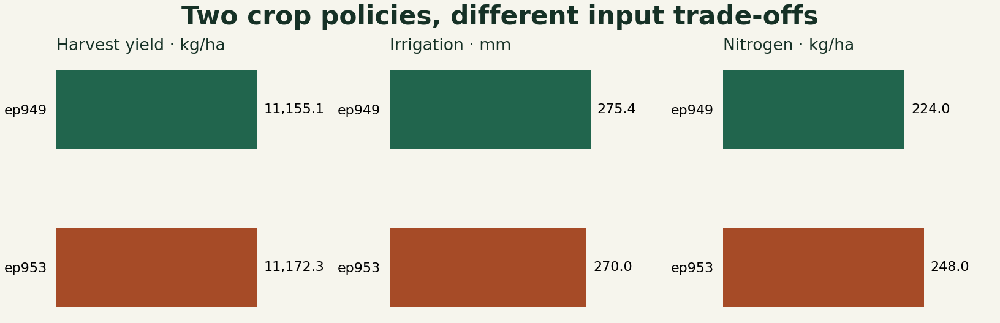
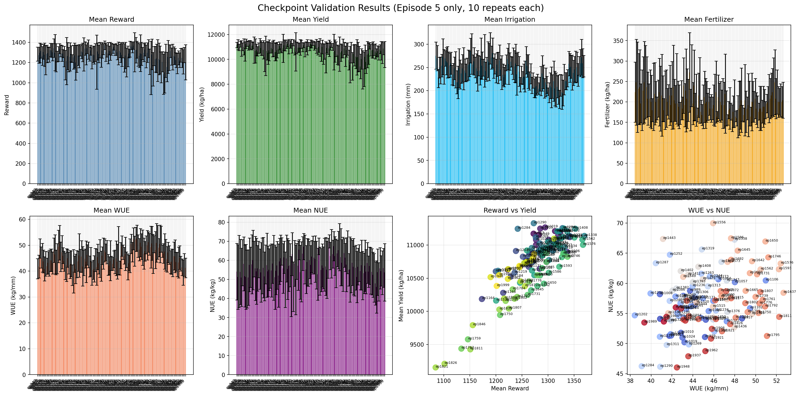
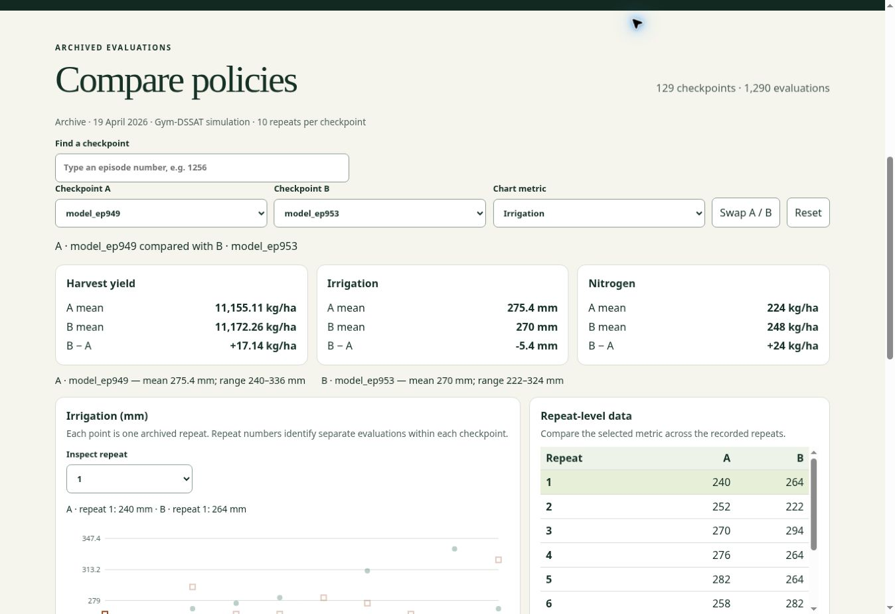
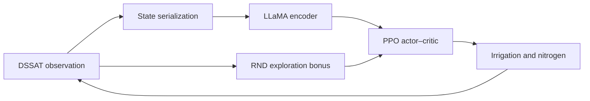

# LLaMA-PPO-RND for Gym-DSSAT

An agricultural reinforcement learning research project for learning **irrigation and nitrogen fertilization policies** in the DSSAT crop simulator. The main experiment combines a LLaMA state encoder, PPO, Random Network Distillation (RND), and progressive observation augmentation.

[](https://github.com/wuyang060826/llama_ppo_rnd_in_gymDssat/actions/workflows/quality.yml)

[Results demo](#results-demo) · [Interactive prototype](#interactive-prototype) · [Method](#method) · [Training](#training) · [Repository map](#repository-map)

## Results demo

**Can a crop policy use less water and maintain yield?** Compare two checkpoints from the same archived Gym-DSSAT evaluation batch. The repository contains **129 checkpoints and 1,290 evaluations**.



| Mean across 10 evaluations per checkpoint | ep949 | ep953 | Difference (953 − 949) |
| --- | ---: | ---: | ---: |
| Harvest yield (kg/ha) | 11,155.11 | 11,172.26 | +17.14 |
| Irrigation (mm) | 275.40 | 270.00 | −5.40 |
| Nitrogen (kg/ha) | 224.00 | 248.00 | +24.00 |
| Reward (score) | 1,282.61 | 1,272.30 | −10.31 |

In this batch, ep953 used less water and more nitrogen, with nearly unchanged mean yield and lower mean reward. Differences are computed before rounding.

<details>
<summary>Open the full validation figure and replication command</summary>



Run the following with Python 3.9+ to summarize the [archived CSV](test/val_proj/batch_val_results_0417/batch_validation_results_20260419_053122.csv) without additional dependencies.

```bash
python scripts/demo_results.py
```

These are historical simulator observations. Repeat numbers do not establish paired weather seeds. An evaluation against matched baselines and held-out seeds is needed to assess comparative performance.

</details>

[Compare any two checkpoints in FieldLab](https://wuyang060826.github.io/llama_ppo_rnd_in_gymDssat/fieldlab/) · [Prototype source and development guide](docs/fieldlab/DEVELOPMENT.md)

## Interactive prototype

Search checkpoints, compare six metrics, inspect individual repeats, and export the selected evaluations. The screenshot below shows the verified desktop interface.

[](https://wuyang060826.github.io/llama_ppo_rnd_in_gymDssat/fieldlab/)

[Open FieldLab](https://wuyang060826.github.io/llama_ppo_rnd_in_gymDssat/fieldlab/) · [Verification record](docs/review/VALIDATION.md)

## Method



| Component | Implementation |
| --- | --- |
| State representation | Serialize the numerical observation as text and project LLaMA hidden states into the policy input. |
| Action space | 25 discrete combinations of five irrigation and five nitrogen application levels, subject to state-based application guards. |
| Extrinsic objective | Deduct irrigation and fertilizer costs at each step and credit the recorded yield at episode termination. |
| Intrinsic objective | Use RND prediction error to encourage exploration. |
| Progressive augmentation | Keep observations unchanged through 40% of training, ramp augmentation from 40% to 60%, then apply full strength. |

## Training

The main entry point uses the legacy Gym API and requires a Linux environment with an executable DSSAT-PDI runner, a BF16-capable NVIDIA GPU, and LLaMA weights compatible with Transformers. The archived experiment used a local Chinese-LLaMA-2-1.3B model directory.

1. Install a CUDA-enabled PyTorch build for your system using the [PyTorch installation guide](https://pytorch.org/get-started/locally/).
2. Install the Python dependencies. Gym 0.21 may require legacy packaging tools in a dedicated Python 3.9 environment.

   ```bash
   python -m pip install "pip<24.1" "setuptools==65.5.0" "wheel==0.38.4"
   python -m pip install --no-build-isolation -r requirements.txt
   ```

3. Install the [Gym-DSSAT-PDI fork and simulator](https://github.com/GijsvanDijck/gym-dssat-pdi) following its setup instructions.
4. Run a one-episode setup check with your local model and runner paths.

   ```bash
   python main/llama_ppo_rnd/llama_ppo_rnd_update_glm5_v3.py \
     --model /path/to/chinese-llama-2-1.3b \
     --dssat-runner /opt/dssat_pdi/run_dssat \
     --output-dir runs/smoke \
     --episodes 1
   ```

Use `--seed` to set the training RNG and simulator seed. Each run records its arguments, configuration, and Python/PyTorch/NumPy versions in `run.json`. Validation uses the fixed seed set defined in the main script.

For the configured 2,000-episode experiment, omit `--episodes` and choose a fresh output directory. The run writes simulator logs, metric exports, and qualifying checkpoints under that directory. A one-episode run checks setup and runs final validation. PPO updates and checkpoint saves depend on thresholds in the training script. This environment setup has not been verified end to end.

## Repository map

| Path | Purpose |
| --- | --- |
| [main/llama_ppo_rnd](main/llama_ppo_rnd) | Main PPO + LLaMA + RND implementation and earlier variants. Use the v3 script for the command above. |
| [main/bert_dqn](main/bert_dqn) | BERT-based DQN reproduction experiments. |
| [main](main) | Additional PPO, DQN, RND, MCTS, DreamerV3, and MBPO experiment scripts. |
| [test/val_proj](test/val_proj) | Historical checkpoint evaluation scripts and outputs. Some scripts use experiment-specific local paths. |
| [test/LM_AG-main](test/LM_AG-main) | Upstream reference notebooks and assets from [LM_AG](https://github.com/jingwu6/LM_AG). |
| [scripts/demo_results.py](scripts/demo_results.py) | Dependency-free demo of the checked-in validation data. |
| [scripts/fieldlab_data.py](scripts/fieldlab_data.py) | Shared archive validation for the CLI, browser bundle, and README figure. |
| [docs/fieldlab](docs/fieldlab) | Interactive UI, data model, generated archive, and development guide. |
| [main/llama_ppo_rnd/training_core.py](main/llama_ppo_rnd/training_core.py) | CPU-testable rollout buffer and learning-rate schedule. |
| [tests](tests) | Focused regressions for numerical behavior, data integrity, exports, and training CLI. |

## Development

```bash
python -m unittest discover -s tests -p 'test_*.py'
node --test tests/fieldlab.test.cjs
python scripts/build_fieldlab.py --check
```

Python regressions require NumPy and PyTorch. The Node tests use the built-in test runner in Node 20+. CI checks Python 3.9 and 3.12 using CPU PyTorch. See the [21-round review record](docs/review/ITERATIONS.md) and [development guide](docs/fieldlab/DEVELOPMENT.md) for design references and verification scope.

The active training script now fails explicitly when an episode hits its step limit before termination, preventing incomplete episodes from entering reported harvest metrics. The numerical fixes require fresh experiments before comparing new results with the historical archive.

## References and reuse

- [The New Agronomists](https://arxiv.org/abs/2403.19839) and its [LM_AG repository](https://github.com/jingwu6/LM_AG) provide the language-model crop management baseline.
- [Proximal Policy Optimization](https://arxiv.org/abs/1707.06347) and [Random Network Distillation](https://arxiv.org/abs/1810.12894) describe the learning methods used here.
- The repository currently has no standalone license file. Check the applicable upstream terms for third-party notebooks, model weights, and simulator components before redistribution.
